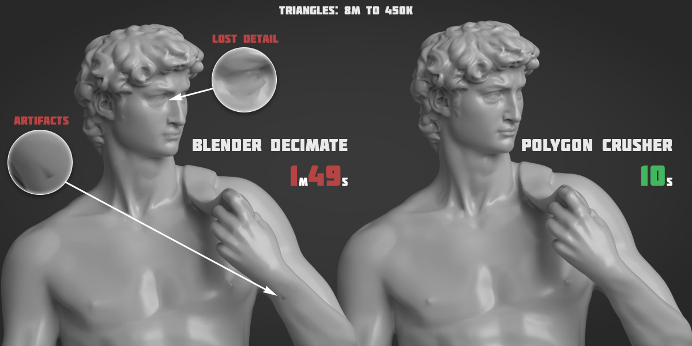
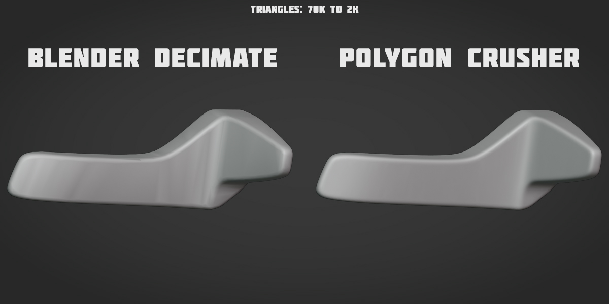
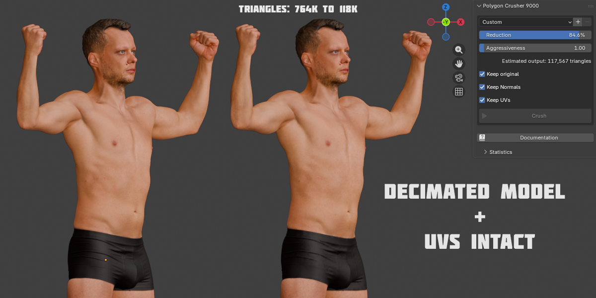
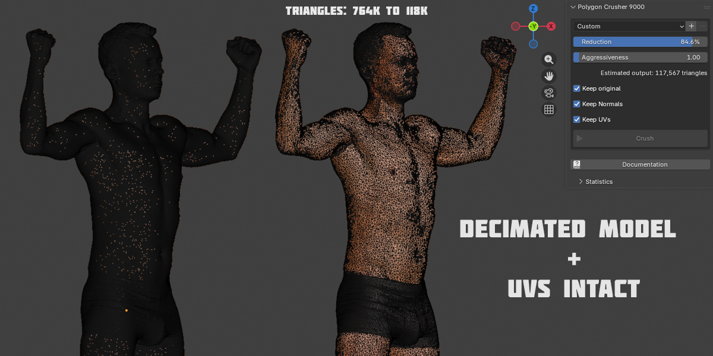

# Examples

!!! note
    These images were made with older versions (2.1 to 2.3). The results
    today are the same or better: every test model in the 2.12.20 check came
    out as good as or better than 2.8.0. See [What's New](whats-new.md).

## High-poly sculpt — 8M → 450K triangles

A photogrammetry-grade scan crushed to about 6% of its original triangle count.
The timings in this image come from an older test (version 2.1, machine not
recorded). Our repeatable test measured about 3× faster than Blender's
built-in Decimate on meshes of 1–7.5 million triangles; see the
[Benchmark](benchmark.md) page.

---

## Hard-surface mesh — 70K → 2K triangles

A 97% reduction on a hard-surface mesh. Polygon Crusher preserves the silhouette
and curvature of the original shape on a tight triangle budget, where Decimate
distorts the form.

---

## Textured photogrammetry scan — 764K → 118K triangles, textures kept

A full-body 3D scan crushed by ~85% with **Textures** switched on under
**Keep**. The decimated mesh keeps the original UV map intact, so the
photographic texture stays correctly mapped onto the lower-poly result: no
re-baking, no seam distortion.

The wireframe view of the same crush makes the topology change explicit —
dense original on the left, ~85% lighter decimated result on the right:

---

## Remesh to clean quads

Remesh turns a dense scan or sculpt into evenly sized quads at the count you
ask for, for example a 60,000-triangle scan rebuilt with a sixth of the
faces. See [Remesh (Quads)](features/remesh.md).

