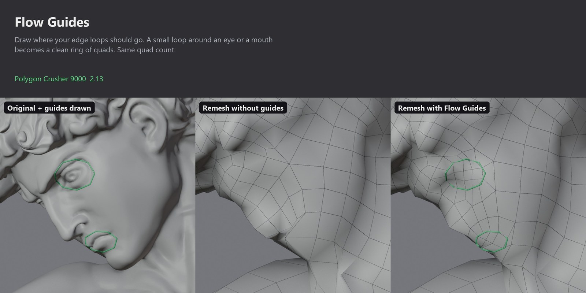

# Flow Guides

Flow Guides let you draw where a Remesh should run its edge loops: around a
leg, along the body, around an eye or a mouth. They only appear while
**Remesh** is selected.

## How to use it

1. Under **2 Output**, pick **Remesh**.
2. Open **Advanced → Edges** and click **Draw Flow Guides**. Blender switches
   to the Annotate tool.
3. Draw lines on the model where you want edge loops. Each stroke snaps to the
   surface and shows in green.
4. Click **Done Drawing**, then **Crush**.

**Clear Guides** removes every guide on the model. The panel shows how many
guides the active model has.

## Open lines and closed loops

- **Open lines** (along a leg, a spine, a spiral) steer the quads, so loops
  run along your line. On a sphere with a spiral guide, all quads followed it
  (15% without the guide).
- **Small closed loops** (around an eye or a mouth, up to about 30 quads
  round) are cut into the result as a clean ring of quads. On the statue's
  eye: 91% of a proper ring, against 4% without the guide.
  At very low counts a loop that would get fewer than 6 quads round is
  skipped, and the status line says so.
- Bigger closed loops, and loops drawn round a leg, an arm or the body, are
  treated like open lines.

## Good to know

- Works together with **Symmetry**, **Adaptive Density** and **Quad Density**
  paint. With Symmetry, draw on one half: the guide is mirrored.
- The count stays within a few percent of what you asked for.
- Each closed ring adds a few poles at its corners.
- Open lines change how the quad engine lays out the whole model, not only
  near the line, so the rest of the result also differs a little.
