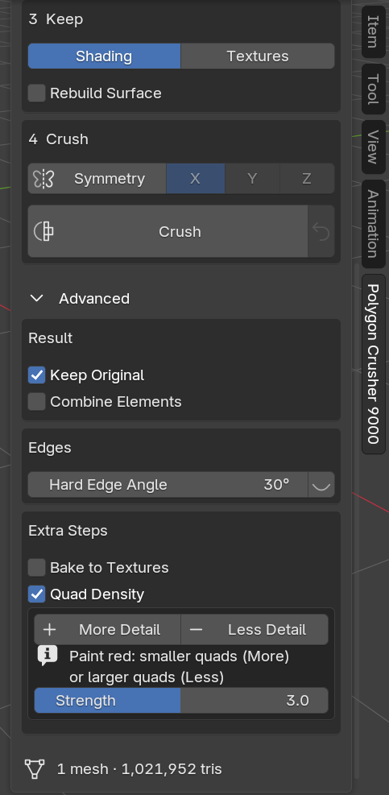

# Quad Density

Quad Density lets you paint where a Remesh should use smaller or larger
quads: smaller on a face, hands or a logo; larger on a flat back, the
underside or parts nobody sees. It only appears while **Remesh** is selected.

The quad count stays what you asked for. Smaller quads in the painted area
mean slightly larger ones in the rest of the model, and the other way round.

## How to use it

1. Under **2 Output**, pick **Remesh**.
2. Open **Advanced → Extra Steps** and tick **Quad Density**.
3. Click **More Detail** to paint smaller quads, or **Less Detail** to paint
   larger quads. Blender opens Weight Paint on its own group
   (**Quad Density** or **Quad Density Less**). The button of the group you
   are painting stays pressed, and you can switch between the two.
4. Paint **red** where you want the change. Soft paint gives an in-between
   size with a smooth change at the edge.
5. Click **Done Painting**, then **Crush**.

## Strength

**Strength** (1 to 8, default 3) says how many times smaller (More Detail) or
larger (Less Detail) the quads get where you painted at full weight. 3 means
up to three times.

## Good to know

- Painted areas get the smaller quads you ask for even on models with thin
  parts, and thin unpainted parts (legs, tails) no longer tear when quads move
  to the painted area (2.13.0).
- For automatic sizing without painting, tick **Adaptive Density** instead.
  See [Remesh](remesh.md#adaptive-density). Both together: your paint wins
  where you painted.
- It works with a Mirror modifier (paint one half, both get it), with
  **Symmetry**, and on sewn garments and many-part models.
- On a scanned human with the head painted **More Detail**, the head came out
  with quads half the size (four times as many) for the same 2,000 quads
  overall. Painted **Less Detail**, the quads were almost twice as large.
- A part smaller than one of the big quads (fingers, a fist) loses its shape
  under Less Detail. Leave small parts unpainted, or lower **Strength**.
