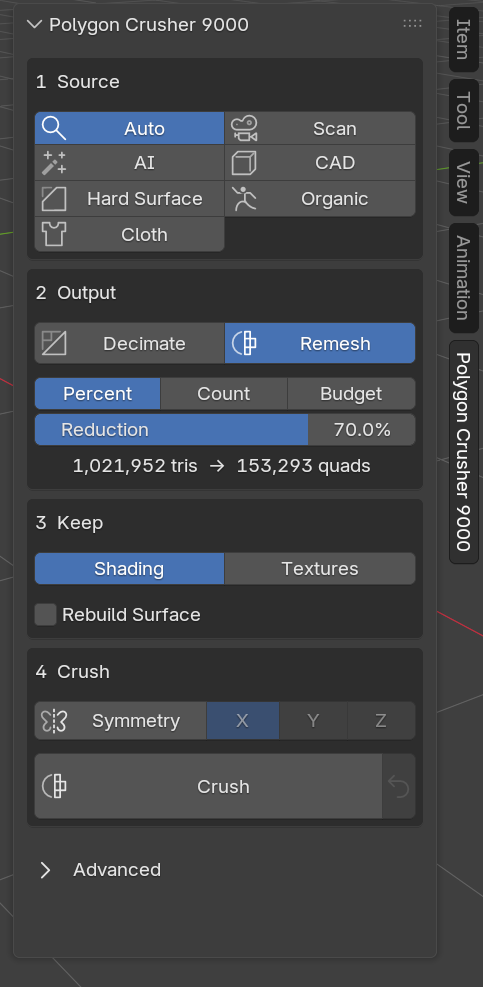
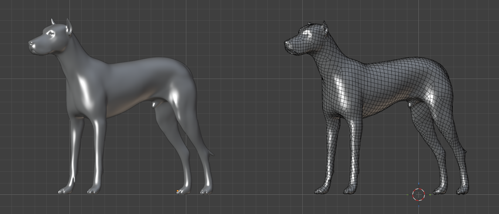

# Remesh (Quads)

**Decimate** keeps the original surface and reduces its triangles.
**Remesh** throws the old triangles away and builds the model again from
clean, even quads. Use it when you want to keep editing the model, sculpt on
it, subdivide it or animate it. Use Decimate when you need exact triangle
counts for a game, or when the original must stay exactly as it is.

Click the **Remesh** tab under **2 Output**, set the amount, and click
**Crush**. The main button is the same: it does the job of the tab you chose.

---

## The count you ask for is the count you get

The amount works like Decimate's (**Percent**, **Count** or **Budget**) and
is turned into quads: half the triangles the amount would keep. The panel
shows `tris → quads` before you start. The quad engine on its own overshoots a
target by three or four times. Polygon Crusher searches for the setting that
lands on your number, and the status box under **Keep** tells you the real
count it reached (for example "4,329 faces, 88.9% quads"). If it had to
spend more quads to avoid damage, it says that too.

Models made of loose parts, or parts too small for a quad, come out with a
share of triangles joined into quads (often 60 to 90% quads).

## What is automatic

Remesh has very few switches because it looks at the model and decides:

- **CAD parts** (Source: Auto, CAD or Hard Surface). If the model is made of
  flat faces with round holes and straight walls, it builds a clean graded
  grid: flat faces stay flat, every hole is a closed round loop, and the hard
  edges get quad loops. The quads inside flat faces are evened out. Very low
  counts get a coarser all-quad grid. If the model needs more quads than you
  asked for, the status says so (a block with many holes needs at least about
  1,240). Models that are not flat faces with round holes use the general
  remesh.
- **Many-part models** (game weapons, kits of hundreds of parts). Each big part
  is remeshed on its own and checked against the original. Parts too small or
  thin for the quad size are simplified as triangles at their share of the
  budget, then paired into quads, so nothing vanishes.
- **Sewn garments** (Marvelous Designer, CLO). The panels are sewn together and
  remeshed in one run.
- **Scans.** Cracks between patches are closed first (the same repair as
  **Fill Holes**), so the quads no longer show every crack.
- **Faces pointing both ways** (common in 3D-print exports). They are turned to
  agree first, and the shading is copied from the fixed copy, so edges do not
  show dark nicks.
- **Thin walls and bars.** When most walls are about as thin as a quad, the
  result is also built from a simplified copy and the one that fits the
  original better is kept.
- **Sharp edges.** Hard edges and edges you marked Sharp steer the quad loops:
  on a hard-surface model most of the sharp edges are followed by a loop.
  With **Sharps** on (Hard Surface and CAD sources), small round holes stay
  round and beveled corners stay crisp.
- **Damage repair.** If a remesh tears holes in a closed model, it tries again
  with more quads until the result is clean.
- **UVs and materials.** With **Textures** on, UVs and materials are carried to
  the result, and a bake is made automatically if the UV seams would leave
  cracks. Vertex colors are kept.
- **A stuck engine.** If the quad engine stops making progress, it is stopped
  and the next option is tried.

## The switches you have

- **Source** — pick the right one. See [Source Types](source-types.md).
- **Shading** — the result takes the original's shading, so the surface still
  reads the same with far fewer faces.
- **Textures** — keep UVs and materials. With **Bake to Textures** on, you can
  also tick **Bake Into Kept UVs** to bake into the carried UV layout instead of
  a fresh unwrap. See [Bake Maps and Auto UVs](bake-maps.md).
- **Sharps** — Hard Surface and CAD only.
- **Symmetry** — remeshes one half and mirrors it, so both sides have the same
  quads and the seam runs straight down the middle. It uses the axis you pick
  (X, Y or Z).
- **Rebuild Surface** — off by default. For hopeless input: triangle soups
  of loose strips, open or self-crossing models. It rebuilds a closed skin
  first, then remeshes it. Details finer than the skin and your Sharp marks
  are lost. With it off, nothing changes.
- **Quad Density** (Advanced) — paint where you want smaller or larger quads.
  See [Quad Density](quad-density.md).
- **Show Hard Edges** (Advanced) — see which edges the quad loops will follow.
  See [Show Hard Edges](show-hard-edges.md).

**Keep Original** works as in Decimate, with one difference: Remesh leaves
the source in place, and **Revert** cannot go back to it when Keep Original is
off (the panel shows a red warning).

LODs, Clean Mesh, Protect and the flat-area options are hidden while Remesh
is selected.

After a Remesh the new mesh is selected and active.

## Best on, and not for

Remesh is best on scans, sculpts, organic shapes, garments and CAD parts. On a
hard-surface model with many bevels (a game weapon), Decimate with **Sharps**
keeps the edges crisper, so use Decimate there if crisp hard edges matter more
than quads.

The quad engine's result differs slightly between processors (Apple Silicon
and Intel, for example), because they round floating-point maths differently.
On your own computer, the same model with the same settings gives the same
mesh every time.

## Progress

While it runs, the Crush button becomes **Cancel** with a progress bar that
steps through Reading, Preparing, Remeshing, Building, Shading and Baking.
The slow steps run in small pieces, so Blender keeps redrawing.
