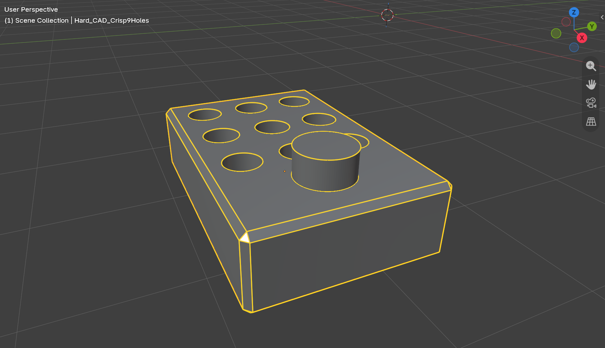

# Show Hard Edges

Show Hard Edges draws, in the viewport, the edges that will be kept in place,
before you crush. You see what **Sharps** and the Hard Edge Angle will hold,
and can change them until it looks right. It is only a viewport overlay:
nothing is added to your scene.

It works for **Decimate** and **Remesh** and for every kind of model (before
2.9.3 it was CAD only).

## How to use it

1. Open **Advanced** and go to the **Edges** box.
2. Click the eye button (next to **Hard Edge Angle**, or alone for Organic,
   Scan and Cloth sources).
3. Change **Hard Edge Angle**, or mark and clear Sharp edges in Edit Mode.
   The lines update as you go.

## The colors

| Color | Edges |
|-------|-------|
| Yellow | Sharper than the Hard Edge Angle |
| Cyan | Marked Sharp (any angle) |
| Purple | Borders between materials |
| Red | UV seams (when **Textures** is on) |
| Green | Open borders (holes and cut edges) |

A key under the button lists only the colors that apply right now.

On a model that looks like a scan, the panel says **Looks like a scan: only
marked Sharp kept**: angle-based edges would just be noise there.

## Hard Edge Angle

**Angle** — default **30°**. Edges where two faces meet at a sharper angle
than this count as hard edges. Edges you marked Sharp are kept at any angle.
Raise the angle to let a detected edge go; use **Clear Sharp** in Blender to
let a marked one go. The setting is hidden for Organic, Scan and Cloth.

See [Hard Surface and Sharps](hard-surface.md).
