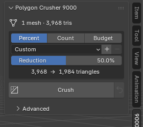

# Quick Start

## The Polygon Crusher Panel

Once the addon is installed, open the **N-panel → 9000 Toolkit tab** in the 3D
Viewport and open the **Polygon Crusher 9000** panel. It starts collapsed.

The main panel holds what you need for most models: a status line, the
**Mode** menu, the **Target** box, and the **Crush** and **Revert**
buttons. Everything else (Preserve, Protect Area, Bake, Clean Mesh, LODs
and Output) is in the collapsed **Advanced** section below it, in groups
that fold on their own. When something in Advanced is switched on, a line
under Crush lists it. The [Settings Reference](../settings.md) describes
every control.

{ .ui-panel }

---

## Basic Workflow

1. **Select** one or more mesh objects in the 3D Viewport
2. Open the **Polygon Crusher 9000** panel (press **N** → 9000 Toolkit tab)
3. Leave **Mode** on **Auto**. It looks at the mesh, says what it sees
   ("Looks like a scan: rough surface all over. Found: 120 spikes, 11
   small holes") and sets the switches to match. Or pick **Scan**,
   **Sculpt** or **Hard Surface** yourself. See [Modes](../features/modes.md)
4. Pick a target mode: **Percent**, **Count** or **Budget**, and set the value.
   In Percent mode you can also pick a preset: **Light · 25%**, **Medium ·
   50%**, **Heavy · 75%** or **Extreme · 90%**
5. Click **Crush**

The addon will:

- Evaluate each selected object's full modifier stack and crush the resulting mesh
- Copy the original surface normals onto the result (when **Keep Normals** is on)
- Place the result in a **Crushed** collection at the scene root
- Hide the original (or delete it, depending on **Keep Original**)
- Keep smooth shading if any face on the source was smooth

The crushed copy lands at the source's exact world transform and is named
`<original name>_crushed`.

The status bar shows a report with the triangle count before and after. Check
it. Some options can stop a crush above the target. See [Limits](../limits.md).

---

## Choosing a Target

| Mode | Use it when |
|------|-------------|
| **Percent** | You want to remove a share of the triangles from every object. |
| **Count** | Every object needs the same triangle count. |
| **Budget** | The whole selection has one triangle budget. Detail goes where it costs least. |

Under the target control, the panel shows a live `before → after triangles`
readout, so you can see what the setting means before you click Crush. See
[Target Modes](../features/target-modes.md).

In Percent mode, these are common values:

| Reduction | Use Case |
|-----------|----------|
| **20–40%** | Light clean-up; barely noticeable up close |
| **50–70%** | Background props, secondary assets (default 50%) |
| **80–95%** | Distant objects, real-time assets |

---

## Tips

### For 3D Scans and Photogrammetry

**Auto** recognises a scan and switches on Clean Mesh with the repairs it
found (table, spikes, small holes) and Keep UVs with Low Distortion; or
pick **Scan** mode. Vertex colors carry over to the crushed mesh by
themselves. To put the detail into texture maps instead, turn on **Normal
Map** and **Base Color** under **Bake**. See
[Bake Maps and Auto UVs](../features/bake-maps.md) and
[Clean Mesh](../features/clean-mesh.md).

### For Hard-Surface and CAD Parts

**Auto** recognises flat faces and sharp edges and picks **Hard Surface**,
which keeps borders, material borders, UV seams and sharp edges exactly in
place; or pick it from the Mode menu. See
[Hard Surface Preservation](../features/hard-surface.md).

### Keeping Detail in One Area

In Edit Mode, select the faces to keep and click **Add** under **Protect
Area** in Advanced. See [Protect Areas](../features/protect.md).

### Making LODs

Tick **Make LODs** in Advanced and click **Crush LODs**. See [LODs](../features/lods.md).

### Working with Modifiers

Polygon Crusher reads the **evaluated** mesh, which is whatever the viewport
shows, including booleans, subdivision, remesh, and any other modifier on the
stack. The original object and its modifier stack are left untouched. The
crushed result is a fresh static mesh with no modifiers.

### Processing Multiple Objects

Select all the objects you want to crush before clicking **Crush**. They run at
the same time, up to one job per CPU core.

Press **ESC** at any time to cancel the run.

### Going Back

Select the crushed object and click the **Revert** button next to Crush. It
deletes the crushed object and brings back the original. This needs **Keep
Original** to be on. See [Keep Original and Revert](../features/revert.md).

---

## After Crushing

**Last Crush**, at the bottom of Advanced, shows the triangle counts, total
time and passes for the active crushed object. Click **Details** for the time
of each phase.
