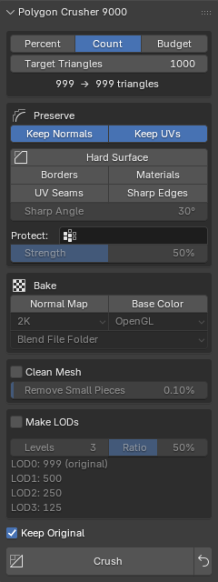

# Quick Start

## The Polygon Crusher Panel

Once the addon is installed, open the **N-panel → 9000 Toolkit tab** in the 3D
Viewport and open the **Polygon Crusher 9000** panel. It starts collapsed.

The panel has a **Target** section, **Preserve**, **Bake**, **Cleanup** and
**LODs** sections, a **Keep Original** checkbox, the **Crush** and **Revert**
buttons, and a collapsible **Statistics** sub-panel. The
[Settings Reference](../settings.md) describes every control.

{ .ui-panel }

---

## Basic Workflow

1. **Select** one or more mesh objects in the 3D Viewport
2. Open the **Polygon Crusher 9000** panel (press **N** → 9000 Toolkit tab)
3. Pick a target mode: **Percent**, **Count** or **Budget**, and set the value
4. Click **Crush**

The addon will:

- Evaluate each selected object's full modifier stack and crush the resulting mesh
- Copy the original surface normals onto the result (when **Keep Normals** is on)
- Place the result in a **Crushed** collection at the scene root
- Hide the original (or delete it, depending on **Keep Original**)
- Keep smooth shading if any face on the source was smooth

The crushed copy lands at the source's exact world transform and is named
`<original name>_crushed`.

The status bar shows a report with the triangle count before and after. Check
it. Some options can stop a crush above the target. See [Limits](../limits.md).

---

## Choosing a Target

| Mode | Use it when |
|------|-------------|
| **Percent** | You want to remove a share of the triangles from every object. |
| **Count** | Every object needs the same triangle count. |
| **Budget** | The whole selection has one triangle budget. Detail goes where it costs least. |

Under the target control, the panel shows a live `before → after triangles`
readout, so you can see what the setting means before you click Crush. See
[Target Modes](../features/target-modes.md).

In Percent mode, these are common values:

| Reduction | Use Case |
|-----------|----------|
| **20–40%** | Light clean-up; barely noticeable up close |
| **50–70%** | Background props, secondary assets (default 50%) |
| **80–95%** | Distant objects, real-time assets |

---

## Tips

### For 3D Scans and Photogrammetry

Leave **Keep Normals** and **Keep UVs** on. If the scan has vertex colors and
no UVs, turn on **Normal Map** and **Base Color** under **Bake** to put the
detail into maps. See [Bake Maps and Auto UVs](../features/bake-maps.md). If
the scan or AI model crushes into fragments, turn on
[Clean Mesh](../features/clean-mesh.md).

### For Hard-Surface and CAD Parts

Click **Hard Surface** in the Preserve section. It keeps borders, material
borders, UV seams and sharp edges exactly in place. See
[Hard Surface Preservation](../features/hard-surface.md).

### Keeping Detail in One Area

Paint a vertex group and pick it under **Protect**. See
[Protect Areas](../features/protect.md).

### Making LODs

Tick **Make LODs** and click **Crush LODs**. See [LODs](../features/lods.md).

### Working with Modifiers

Polygon Crusher reads the **evaluated** mesh, which is whatever the viewport
shows, including booleans, subdivision, remesh, and any other modifier on the
stack. The original object and its modifier stack are left untouched. The
crushed result is a fresh static mesh with no modifiers.

### Processing Multiple Objects

Select all the objects you want to crush before clicking **Crush**. They run at
the same time, up to one job per CPU core.

Press **ESC** at any time to cancel the run.

### Going Back

Select the crushed object and click the **Revert** button next to Crush. It
deletes the crushed object and brings back the original. This needs **Keep
Original** to be on. See [Keep Original and Revert](../features/revert.md).

---

## After Crushing

Open the collapsible **Statistics** sub-panel under the Polygon Crusher 9000
panel to see triangle counts and per-phase timings for the active crushed
object.
