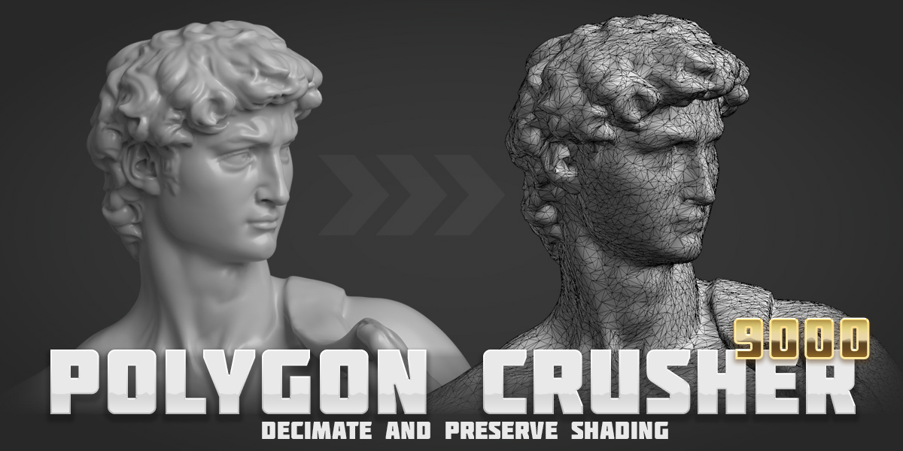

## What is Polygon Crusher 9000?

Polygon Crusher 9000 is a Blender add-on that makes heavy models light. It
does two jobs:

- **Decimate** reduces the triangle count and keeps the shape, the shading,
  the textures and the hard edges.
- **Remesh** rebuilds the model as clean, even quads, at the quad count you
  ask for.

You tell it what kind of model you have (a scan, an AI model, a CAD part,
a character, a garment), how much you want left, and what to keep. The
rest is automatic. The work runs in a separate process, so Blender stays
responsive, and you can cancel at any time.

Built for: 3D scans, sculpts, AI-generated models, hard-surface and CAD
parts, clothing, and LODs for games.

[Get Started](getting-started/installation.md) · [What's New](whats-new.md) · [Settings Reference](settings.md) · [Limits](limits.md)

---

## Features

- **Source type** — pick **Auto**, **Scan**, **AI**, **CAD**, **Hard Surface**, **Organic** or **Cloth**, and the method for that kind of model is used. See [Source Types](features/source-types.md).
- **Decimate or Remesh** — reduce triangles, or rebuild the model as quads. See [Target Modes](features/target-modes.md) and [Remesh](features/remesh.md).
- **Keep what matters** — **Shading**, **Textures** and, for hard-surface and CAD parts, **Sharps**. With Shading and Textures both off you get the shape only, closed and ready to 3D print. See [Hard Surface and Sharps](features/hard-surface.md).
- **Exact targets** — ask for 80% and you get 80%. Ask for 5,000 triangles and you get 5,000. Remesh lands close to the quad count you ask for. Some options can stop a crush above the target, so check the report. See [Limits](limits.md).
- **Three ways to set the amount** — **Percent**, **Count** (per object), or **Budget** (one total for the whole selection).
- **Quad Density** — paint where you want smaller or larger quads. See [Quad Density](features/quad-density.md).
- **Symmetry** — a mirrored model stays mirrored, on X, Y or Z or the axis of its Mirror modifier.
- **Show Hard Edges** — see in the viewport which edges will be kept before you crush. See [Show Hard Edges](features/show-hard-edges.md).
- **Protect Areas** — paint or select the parts that must keep their detail. See [Protect Areas](features/protect.md).
- **Clean Mesh and Scan Repair** — close cracks and holes, cut the floor, remove spikes. See [Clean Mesh and Scan Repair](features/clean-mesh.md).
- **Import and Crush** — crush an OBJ, PLY or STL file straight from disk, for scans too big for Blender's importers. See [Import and Crush](features/import-crush.md).
- **Bake maps** — bake a normal map and a base color map onto the result, with an **Undo Bake** button. See [Bake Maps and Auto UVs](features/bake-maps.md).
- **LODs in one click** — build a whole LOD chain from the original. See [LODs](features/lods.md).
- **Rigs, shape keys and vertex colors carry over.** See [Rigs, Shape Keys and Vertex Colors](features/carry-over.md).
- **Revert** — delete the result and bring back the original. See [Keep Original and Revert](features/revert.md).
- **Modifier-aware** — works on the *evaluated* mesh, so booleans, subdivision and the rest of the stack are included. The original keeps its modifiers.
- **Live progress and Cancel** — the main button becomes a progress bar and a **Cancel** button while it works.

---

## Requirements

| | |
|---|---|
| **Blender** | 4.2 or later. 4.2 is the lowest version the extension accepts and has not been tested; the add-on is tested on the newest Blender |
| **OS** | Windows (x64), Linux (x64; ARM64 for Decimate), macOS (Apple Silicon and Intel) |

---

## Support

Questions or issues? Email [henriquevlopes@gmail.com](mailto:henriquevlopes@gmail.com)
