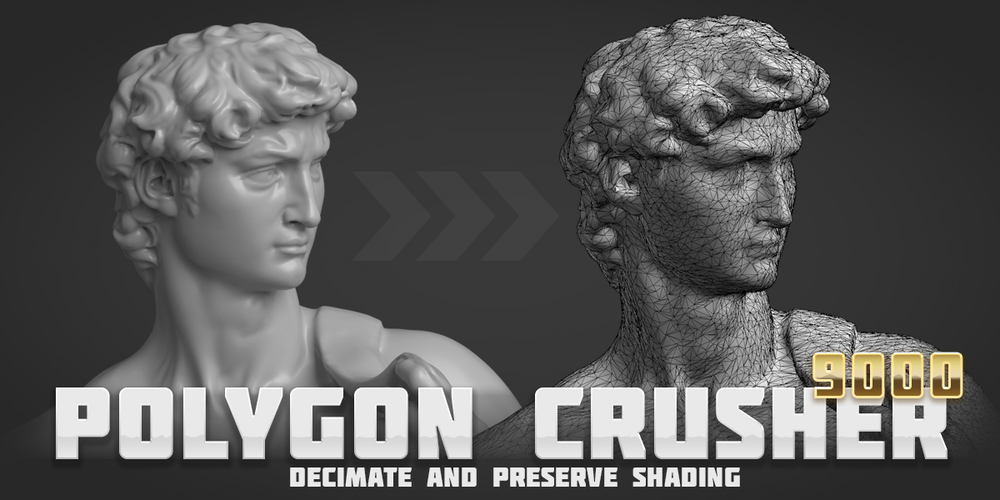

## What is Polygon Crusher 9000?

Polygon Crusher 9000 is a Blender addon for fast, high-quality mesh decimation.
It crushes dense meshes down to the triangle budget your scene needs while
keeping what matters: surface shading, silhouette, UV mapping, and the hard
edges of CAD and hard-surface parts.

Unlike Blender's built-in Decimate, the simplifier runs as a worker subprocess,
so the UI stays responsive. It is modifier-aware and runs several objects at
the same time. You choose the target as a percentage, a triangle count per
object, or one triangle budget for the whole selection.

Built for: 3D scans, sculpts, AI-generated meshes, hard-surface and CAD parts,
LOD generation.

[Get Started](getting-started/installation.md) · [Settings Reference](settings.md) · [Limits](limits.md)

---

## Features

- **Exact targets** — ask for 80% and you get 80%. Ask for 5,000 triangles and you get 5,000. The engine removes the least visible detail first. Some options can stop a crush above the target, so check the report. See [Limits](limits.md).
- **Three target modes** — **Percent**, **Count** (per object), or **Budget** (one total for the whole selection). See [Target Modes](features/target-modes.md).
- **Normal Preservation** — copies the original's surface normals onto the result, so smooth shading survives heavy crushing.
- **Hard Surface Preservation** — keep borders, material borders, UV seams and sharp edges in place, and still reach the count you asked for. See [Hard Surface Preservation](features/hard-surface.md).
- **Protect Areas** — select faces in Edit Mode (or paint a vertex group) to keep detail in faces, hands or text. See [Protect Areas](features/protect.md).
- **Clean Mesh** — repair AI-generated and scanned meshes before crushing. See [Clean Mesh](features/clean-mesh.md).
- **Import and Crush** — crush an OBJ, PLY or STL file straight from disk, for scans too big for Blender's importers. The engine reads the file; only the crushed result, with its UVs, textures, materials and vertex colors, is built in Blender. See [Import and Crush](features/import-crush.md).
- **Bake Maps and Auto UVs** — bake normal and base color maps onto the crushed mesh, with the base color taken from the original's image textures or vertex colors. Meshes without UVs get UVs made for them. See [Bake Maps and Auto UVs](features/bake-maps.md).
- **LODs in one click** — build a whole LOD chain from the original. See [LODs](features/lods.md).
- **Rigs, shape keys and vertex colors carry over** — the crushed copy keeps skin weights, the Armature modifier, shape keys and vertex colors, so a rigged character still poses. See [Rigs, Shape Keys and Vertex Colors](features/carry-over.md).
- **Revert** — delete a crushed object and bring back its original. See [Keep Original and Revert](features/revert.md).
- **Modifier-Aware** — crushes the *evaluated* mesh; boolean, subdivision, and the rest of the modifier stack are applied automatically. The original's modifiers stay untouched.
- **Live Progress** — Blender stays responsive during long crushes. Press **ESC** at any time to cancel.
- **Session Stats** — per-object triangle counts and timing, directly in the panel.

---

## Requirements

| | |
|---|---|
| **Blender** | 4.2 or later |
| **OS** | Windows (x64), Linux (x64, ARM64), macOS (Apple Silicon) |

---

## Support

Questions or issues? Email [henriquevlopes@gmail.com](mailto:henriquevlopes@gmail.com)
