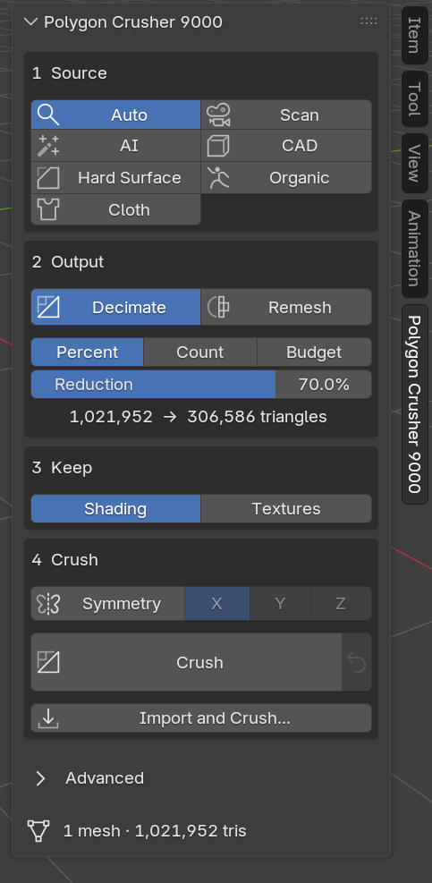
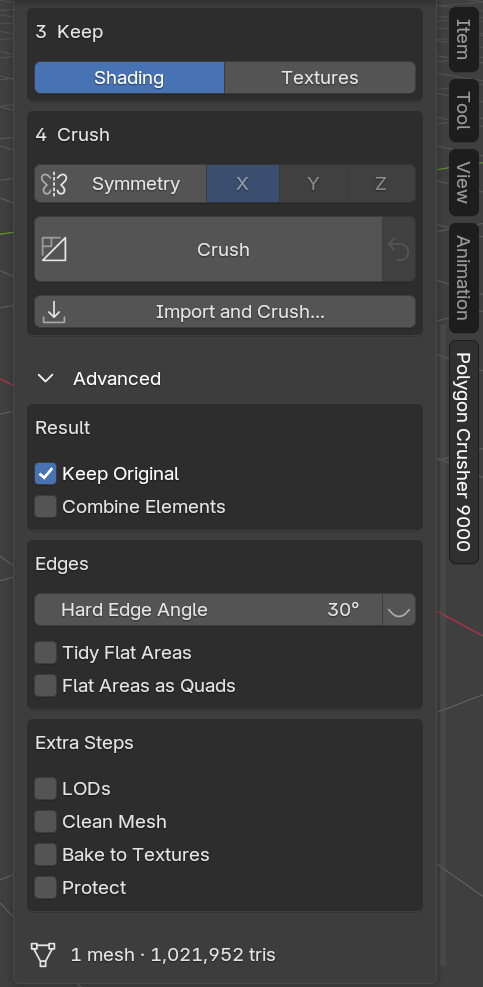

# Settings Reference

All settings are in the **Polygon Crusher 9000** tab of the 3D Viewport
sidebar (press **N**). The panel goes top to bottom in four steps, then a
collapsed **Advanced** section holds the rest.

Settings that do not apply to the chosen source or tool are hidden, not
greyed out, so the panel only shows what the next run will use.

---

## Status line

At the very bottom of the tab, the **Selection** line says what is selected:
the number of meshes and their triangle total. With nothing selected it says
"Select a mesh object to start".

---

## 1 Source

**Seven buttons** — default **Auto**

What kind of model this is: **Auto**, **Scan**, **AI**, **CAD**, **Hard
Surface**, **Organic**, **Cloth**. Picking one uses the method for that kind
and sets a starting amount. With Auto, a line under the buttons says **Last
run treated it as: ...** after a run. See [Source Types](features/source-types.md).

---

## 2 Output

### Decimate / Remesh

**Two tabs** — default **Decimate**

- **Decimate** reduces the triangles and keeps the shape, shading and
  textures.
- **Remesh** rebuilds the model as clean, even quads. See
  [Remesh (Quads)](features/remesh.md).

### Percent, Count, Budget

**Three buttons** — default **Percent**

- **Percent** — remove a share of the triangles.
- **Count** — each selected object is crushed to a count.
- **Budget** — one total for the whole selection.

See [Target Modes](features/target-modes.md). The control below the buttons
changes with the choice:

- **Reduction** (Percent): 1% to 99%, default **50%** (the source sets a
  starting value). Dragging covers 5% to 95%.
- **Target Triangles** (Count): minimum 4, default **5000**. An object with
  fewer triangles than this is left at its own count.
- **Total Triangles** (Budget): minimum 4, default **100,000**.

The result never has fewer than 4 triangles.

Under the control, a readout shows `before → after triangles` (or `tris →
quads` for Remesh), added up over the selected meshes. The "after" number is
the target, not a promise. See [Limits](limits.md).

---

## 3 Keep

### Shading

**Toggle** — default **on**

The result takes the original's smooth shading, so it does not look faceted,
even when the topology changes a lot. Leave it on for almost all cases.

### Textures

**Toggle** — default **off**

Keeps the UV layout and materials so textures still fit the result. UV seams
are held in place, and the crush refuses collapses that would fold the
texture mapping. It does nothing if the mesh has no UVs.

### Sharps

**Toggle** — default **on**; shows for **Hard Surface** and **CAD** only

Hard edges stay in place and crisp, including small-bevel corners. See
[Hard Surface and Sharps](features/hard-surface.md).

### Shape only

With **Shading** and **Textures** both off, you get the shape only: a closed
mesh ready to 3D print. The panel says so.

### Rebuild Surface (Remesh only)

**Checkbox** — default **off**

For hopeless input (triangle soups, open or self-crossing models). Rebuilds a
closed skin first, then remeshes it. See [Remesh (Quads)](features/remesh.md).

### Remesh status

After a Remesh, a box under the Keep row says what the run did: the real quad
count, the share of quads and any notes.

---

## 4 Crush

### Symmetry

**Toggle + X / Y / Z** — default **off**, axis **X**

Keeps a mirrored model mirrored: both halves are treated the same way and the
center line stays straight and closed. The axis is the object's own X, Y or Z
through its origin, like Blender's Mirror modifier. If the object has an
active **Mirror** modifier, its axis is used instead and the axis buttons are
greyed out. With **Remesh**, one half is remeshed and mirrored. Not used by
**Budget** or **Import and Crush**.

### Crush

The main button. It does the job of the tab you chose (**Crush LODs** while
LODs is on). It is available when at least one mesh is selected.

While it works, the button becomes **Cancel** with a progress bar. Click
**Cancel** or press **ESC** to stop.

### Revert

The small icon next to Crush. Deletes the selected result and brings back its
original. Greyed out when there is nothing to revert. See
[Keep Original and Revert](features/revert.md).

### Import and Crush...

**Button** (Decimate only)

Opens a file browser for an **.obj**, **.ply** or **.stl** file. See
[Import and Crush](features/import-crush.md). Also in **File → Import**.

### Keep Original warning

When **Keep Original** is off, a red line under the button says so: "Original
will be deleted" (Decimate) or "Keep Original is off: Revert won't work"
(Remesh).

When the native binary is missing, the panel shows "Native binary not found"
and Crush refuses to run. See [Troubleshooting](troubleshooting.md).

---

## Advanced

Click **Advanced** to open it. It starts collapsed in every session. It has
four boxes.

### Result

- **Keep Original** (default **on**) — the original is hidden instead of
  deleted. Greyed out while LODs is on. See
  [Keep Original and Revert](features/revert.md).
- **Combine Elements** (default **off**) — joins all the selected meshes into
  one, welds the parts that touch or overlap, and crushes the result once into
  a single object.

### Edges

- **Hard Edge Angle** (default **30°**) with the **eye** button — the eye is
  **Show Hard Edges**. Hidden for Organic, Scan and Cloth sources. See
  [Show Hard Edges](features/show-hard-edges.md).
- **Tidy Flat Areas** (Decimate only; Auto, CAD, Hard Surface) — flips long thin
  triangles on flat areas into even ones. No point moves.
- **Flat Areas as Quads** (Decimate only; Auto, CAD, Hard Surface) — merges the
  triangles of each flat area into one face and pairs the rest into quads.
  Leave it off for game exports that need triangles.

### Extra Steps

Each one opens its options right under it while ticked.

- **LODs** (Decimate only) — **Levels** (1 to 8, default 3) and **Ratio** (5% to
  95%, default 50%). See [LODs](features/lods.md).
- **Clean Mesh** (Decimate only) — **Small Pieces** (0% to 5%, default 0.1%),
  and the **Scan Repair** switches: **Cut Floor** (with **Height** or the
  **Pick Floor** eyedropper), **Remove Spikes**, **Fill Holes** (with **Size**,
  0.1% to 50%, default 5%). The repair switches show for Auto, Scan and AI. See
  [Clean Mesh and Scan Repair](features/clean-mesh.md).
- **Bake to Textures** — **Normal Map**, **Base Color**, **Undo Bake**, **Bake
  Into Kept UVs** (Remesh with Textures on), **Size** (512, 1K, 2K, 4K, default
  2K), **Normal Y** (OpenGL or DirectX), **Save To** (Blend File Folder or
  Custom Folder). See [Bake Maps and Auto UVs](features/bake-maps.md).
- **Quad Density** (Remesh only) — **More Detail**, **Less Detail**, **Done
  Painting**, **Strength** (1 to 8, default 3). See
  [Quad Density](features/quad-density.md).
- **Protect** (Decimate only) — **Paint Protect**, **Done Painting**, **Add**
  and **Remove** (Edit Mode), a vertex group field, **Strength** (0% to 100%,
  default 50%), **Blur** (0% to 100%, default 5%) and **Show Heatmap**. See
  [Protect Areas](features/protect.md).

### Last Crush

Shown after a Decimate, for the **active** crushed object:

- **Object** — the crushed object's name.
- **Triangles** — before → after.
- **Total time** and **Passes**.

Click **Details** for the time of each phase (Extract, Write, Crush, Read,
Build, Bake Normals). "Bake Normals" here is the shading transfer, not the
normal map bake. When several objects are selected they run at the same time,
so the phase times can add up to more than the clock time. The numbers are
only kept for the current Blender session.

---

## Remembered settings

The amount, Hard Edge Angle, LOD and bake size settings are remembered across
files and Blender restarts for new scenes. A file that already has Polygon
Crusher settings keeps its own.
