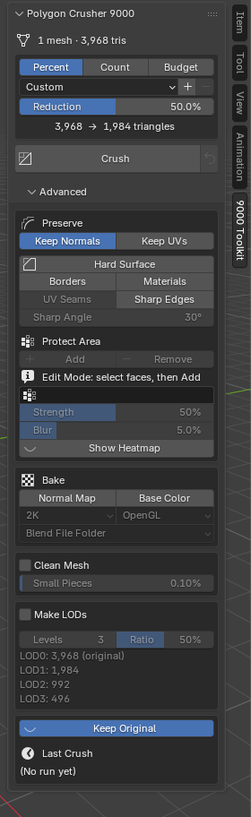

# Settings Reference

All settings are in the **Polygon Crusher 9000** panel. Open the 3D Viewport
sidebar (press **N**) and click the **9000 Toolkit** tab. The panel starts
collapsed every time you open Blender or load a file.

The panel has two levels:

- **The main panel** shows a status line, the **Target** box, and the
  **Crush** and **Revert** buttons. For most models this is all you need.
- **Advanced** is a collapsed section under it. It holds **Preserve** (with
  **Protect Area**), **Bake**, **Cleanup**, **LODs**, **Keep Original** and
  the **Last Crush** results, all visible at once when you open it.

Options that do not apply right now are greyed out instead of hidden. For
example, **Strength** is grey until a Protect Area is set.

{ .ui-panel }

---

## Status line

The first line of the panel says what it is looking at: the number of
selected meshes and their triangle total. With nothing selected it says
"Select a mesh object to start".

## What's on

When anything inside **Advanced** is switched on, a line under **Crush**
lists it, for example "On: Keep UVs · Hard Surface · Normal map". So a
closed Advanced section never hides what the next crush will do. When
**Keep Original** is off, a warning under Crush says the original will be
deleted.

---

## Target

The Target section decides how many triangles you end up with. See
[Target Modes](features/target-modes.md) for how to choose between the three
modes.

### Target Mode

**Three buttons:** **Percent**, **Count**, **Budget** — default **Percent**

- **Percent** — remove a share of the triangles.
- **Count** — crush each selected object to a triangle count.
- **Budget** — one triangle total for the whole selection.

The control below the buttons changes with the mode.

### Preset (Percent mode only)

**Dropdown** with **+** and **−** buttons — default **Custom**

Presets save and recall a set of settings. See [Presets](#presets) below.

### Reduction (Percent mode)

**Slider** — 1% to 99% — default **50%**

Percentage of triangles to remove. **50%** removes half of them. Dragging the
slider covers 5% to 95%. You can type a value from 1% to 99%.

The result never has fewer than 4 triangles.

### Target Triangles (Count mode)

**Number** — minimum 4 — default **5000**

The triangle count each selected object is crushed to. If an object already has
fewer triangles than this, it is not made bigger: the target is clamped to the
object's own triangle count.

### Total Triangles (Budget mode)

**Number** — minimum 4 — default **100,000**

The triangle total for all selected objects together.

### Triangle readout

Under the target control, the panel shows `before → after triangles`, added
up over the selected meshes. It uses the same rounding as the crush. The
readout is hidden while **Make LODs** is on.

The "after" number is the target, not a promise. See [Limits](limits.md).

---

## Import and Crush...

**Button** under Crush

Opens a file browser for an **.obj**, **.ply** or **.stl** file. The engine reads
the file and crushes it; only the result is built in Blender. The file
browser's side panel shows the Target, **Keep UVs**, **Clean Mesh** and an
**OBJ is Y up** switch. See [Import and Crush](features/import-crush.md).

---

## Advanced

Everything below lives in the **Advanced** section. It starts collapsed;
click its header to open it.

## Preserve

### Keep Normals

**Toggle button** — default **on**

Copies the original's surface normals onto the crushed mesh, so smooth
shading survives even when the topology changes a lot. Crease corners keep
their own normals.

Leave this on in almost all cases. Turning it off gives flat, faceted shading
on smooth surfaces.

Greyed out while **Normal Map** baking is on. The bake uses the crushed mesh's
own smooth shading instead. See [Bake Maps and Auto UVs](features/bake-maps.md).

### Keep UVs

**Toggle button** — default **off**

Carries the active UV map through the crush, so textures still line up. If the
mesh has no UVs, this does nothing. Turn it on when the crushed mesh must keep
its UV layout. With it off, baking makes new UVs for the crushed copy. See
[Bake Maps and Auto UVs](features/bake-maps.md).

### Hard Surface

**Button** — turns on **Borders**, **Materials**, **UV Seams** and **Sharp
Edges** together, and sets **Sharp Angle** to **30°**

The button shows as pressed when all four are on. Click it again to turn all
four off. See [Hard Surface Preservation](features/hard-surface.md).

### Borders

**Toggle button** — default **off**

Keeps open borders (holes and cut edges) exactly in place.

### Materials

**Toggle button** — default **off**

Keeps the borders between materials exactly in place.

### UV Seams

**Toggle button** — default **off**

Keeps UV seams exactly in place, so textures do not smear across them. Needs
**Keep UVs**. The button is greyed out when Keep UVs is off.

### Sharp Edges

**Toggle button** — default **off**

Keeps hard edges crisp: edges you marked Sharp, plus edges sharper than
**Sharp Angle**. Bumps from scan noise are ignored. On a mesh that looks like
a scan, only the edges you marked Sharp are kept. The crushed mesh gets these
edges marked Sharp too.

### Sharp Angle

**Angle** — 1° to 180° — default **30°**

Edges where two faces meet at more than this angle count as sharp. Greyed out
unless **Sharp Edges** is on.

### Protect Area

**Add** and **Remove** buttons, and a vertex group field — default empty

Marks areas that keep more detail. In Edit Mode, select faces, edges or
vertices and click **Add**. They go into a vertex group named **Protected**
(or the group already in the field), and the field fills in. **Remove**
takes the selected parts back out. Both buttons only work in Edit Mode.

You can also pick a vertex group you painted yourself in the field. When the
active object is a mesh, the field lists that object's vertex groups. See
[Protect Areas](features/protect.md).

### Strength

**Slider** — 0% to 100% — default **50%**

How strongly the Protect Area resists crushing. Greyed out until a Protect
Area is set.

### Blur

**Slider** — 0% to 100% — default **5%**

How far the protection fades out from the marked area, as a share of the
object's size. **0%** makes a hard edge. Dragging covers 0% to 25%; you can
type up to 100%. Greyed out until a Protect Area is set.

### Show Heatmap

**Toggle button** — default **off**

Colors the selected objects in the viewport by how strongly each part is
protected, with the Blur fade included: blue is free to crush, red is fully
protected. It is only a viewport overlay; nothing is added to the scene.

---

## Bake

Bakes the original's detail onto the crushed mesh as texture maps. See
[Bake Maps and Auto UVs](features/bake-maps.md).

### Normal Map

**Toggle button** — default **off**

Bakes the original's surface detail into a normal map and connects it in copies
of the crushed mesh's materials.

### Base Color

**Toggle button** — default **off**

Bakes the original's color into a base color map and connects it in copies
of the crushed mesh's materials: the image textures feeding Base Color in its
materials, or its vertex colors (active color attribute) where a material has
no image. Objects with neither are skipped.

### Size

**Dropdown** — **512**, **1K**, **2K**, **4K** — default **2K**

Resolution of the baked maps. Greyed out until Normal Map or Base Color is on.

### Normal Y

**Dropdown** — **OpenGL** or **DirectX** — default **OpenGL**

Green channel convention of the saved normal map.

- **OpenGL** (green up): Blender, Unity, Godot.
- **DirectX** (green down): Unreal. It still looks correct in Blender.

Greyed out unless **Normal Map** is on.

### Save To

**Dropdown** — **Blend File Folder** or **Custom Folder** — default **Blend File Folder**

Where the baked maps are saved.

- **Blend File Folder** — the same folder as the .blend file. If the file has
  never been saved, the maps are packed into the .blend instead. The panel
  shows "Unsaved: maps get packed".
- **Custom Folder** — a folder you pick in the **Folder** field. Paths that
  start with `//` are relative to the .blend file. If the field is empty,
  Crush stops and asks you to pick a folder.

---

## Cleanup

### Clean Mesh

**Checkbox** — default **off**

Repairs the mesh before crushing. See [Clean Mesh](features/clean-mesh.md).

### Remove Small Pieces

**Slider** — 0% to 5% — default **0.1%**

Deletes loose pieces that are smaller than this share of the mesh's
triangles. **0%** keeps every piece. Greyed out unless **Clean Mesh** is on.

---

## LODs

### Make LODs

**Checkbox** — default **off**

Makes a chain of LODs instead of one crushed copy. While it is on, the Target
section and **Keep Original** are greyed out, and the **Crush** button reads
**Crush LODs**. See [LODs](features/lods.md).

### Levels

**Number** — 1 to 8 — default **3**

How many LOD levels to make. The original stays as LOD0.

### Ratio

**Slider** — 5% to 95% — default **50%**

The share of triangles each level keeps compared to the level before it. With
**50%**, the levels have 50%, 25%, 12.5% of the original, and so on.

When an object is active, the panel lists the triangle count of every level
under these two controls.

Levels and Ratio are greyed out until **Make LODs** is on.

---

## Keep Original

**Checkbox** — default **on**, at the bottom of Advanced

When on, the original object is **hidden** (eye icon off) after the crush, so
you can compare or go back. When off, the original is **deleted** and only the
crushed result remains.

Greyed out while **Make LODs** is on, because LODs always keep the original.
Revert only works when the original was kept. See
[Keep Original and Revert](features/revert.md).

---

## Crush and Revert

These sit in the main panel, under the Target box.

**Crush** — the main button for every mode. It is available when at least one
mesh object is selected. While a crush runs, the button turns into a progress
bar. Press **ESC** to cancel.

**Revert** — the small icon button next to Crush. Deletes the selected
crushed object and brings back its original. Greyed out when there is nothing
to revert. See [Keep Original and Revert](features/revert.md).

When the native binary is missing, the panel shows "Native binary not found"
and Crush refuses to run. See [Troubleshooting](troubleshooting.md).

---

## Presets

Presets work in **Percent** mode only. The preset row has a dropdown and
**+** and **−** buttons.

**Built-in presets:**

| Preset | Reduction | Keep Normals | Keep UVs |
|--------|-----------|--------------|----------|
| Light · 25% | 25% | on | off |
| Medium · 50% | 50% | on | off |
| Heavy · 75% | 75% | on | off |
| Extreme · 90% | 90% | on | off |

A .blend saved with one of the older built-in presets (from before 2.4.0)
opens with the dropdown on **Custom**. Its values are kept.

Built-in presets turn all four Preserve options (Borders, Materials, UV Seams,
Sharp Edges) off.

A preset stores: Reduction, Keep Normals, Keep UVs, the four Preserve
options, and Sharp Angle. It does not store the target count, Protect, Bake,
Clean Mesh, or LOD settings.

- **+** — save the current values as a new preset. You type a name. Saving
  under the name of one of your own presets replaces it. You cannot use a
  built-in preset name.
- **−** — delete the selected preset. It is only enabled for presets you saved,
  and it asks you to confirm. Built-in presets cannot be deleted.
- Your presets are kept in the add-on preferences, so they stay after you
  restart Blender.
- **Custom** means no preset is selected. If you change Reduction, Keep
  Normals, Keep UVs, a Preserve option or Sharp Angle by hand, the dropdown
  goes back to **Custom**.

---

## Last Crush

At the bottom of Advanced. It shows the most recent crush of the **active**
crushed object:

- **Object** — the crushed object's name.
- **Triangles** — before → after.
- **Total time** — the whole crush for this object.
- **Passes** — how many passes the engine made.

Click **Details** to see the time of each phase:

| Phase | What it measures |
|-------|------------------|
| **Extract** | Reading the source mesh |
| **Write** | Writing the input for the native binary |
| **Crush** | The native simplifier |
| **Read** | Reading the binary's output |
| **Build** | Creating the new Blender mesh and object |
| **Bake Normals** | Transferring the original's normals (Keep Normals) |

"Bake Normals" here is the Keep Normals transfer. It is not the normal map
bake.

When several objects are selected, their crushes run at the same time, so the
phase timings can add up to more than the wall-clock time. That is expected.

The numbers are only kept for the current Blender session. If you select an
object that was not crushed in this session, it says there are no stats for
it.
